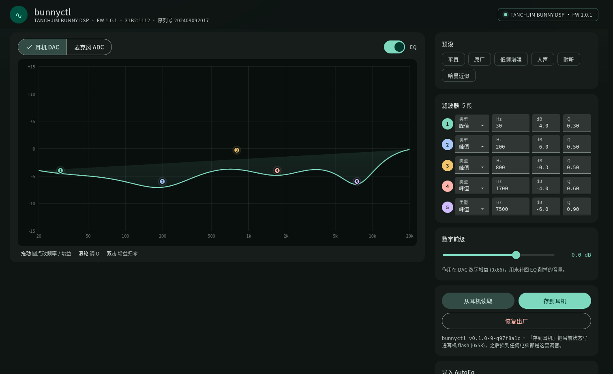

# bunnyctl · 兔几调音台

**在 Linux 上给 TANCHJIM BUNNY DSP 调音。** 浏览器里拖 5 段参数均衡，实时写进耳机，
一键固化到耳机自己的 flash —— 换台电脑、换台手机插上，还是这套声音。



---

## 背景

TANCHJIM（天使吉米）的 BUNNY（兔几）有一条 USB-C「DSP 版」，调音靠官方 App。

官方客户端只覆盖 Android、iOS 和 Windows（[下载中心](https://tanchjim.com/services/) 里是
`TANCHJIM APP` 和 `TANCHJIM PC`），**没有 Linux 版，也没有公开的协议或驱动**。
于是 Linux 用户要么借一台安卓手机调音，要么就只能听出厂曲线。

这个项目补的就是这块：把这条线的 HID 控制通道逆向出来（[协议笔记](docs/PROTOCOL.md)），
做成一个本地 Web 控制台 —— 不用装驱动、不用手机，浏览器打开就能调，调完写进耳机。

## 它做什么

| 功能 | 说明 |
|---|---|
| 5 段参数均衡 | 耳机（DAC）与麦克风（ADC）两条链路，Peak / 低搁架 / 高搁架 / 低通 / 高通 |
| 实时试听 | 图上拖圆点改频率/增益，滚轮调 Q，松手约 160 ms 下发到耳机 |
| 预设 | 平直 / 原厂（从固件里读出的出厂调音）/ 低频增强 / 人声 / 耐听 / 哈曼近似 |
| AutoEq 导入 | 粘贴 `Filter 1: ON PK Fc 105 Hz Gain 5.5 dB Q 0.70` 文本直接套用，Preamp 一起写 |
| 导出 / 导入 | 当前曲线存成 JSON，随时备份、分享或换机恢复 |
| 数字前级 | DAC 数字增益，0.5 dB 步进，补回 EQ 削掉的音量 |
| 写进耳机 | `0x53` 把 RAM 状态提交到 flash，掉电不丢；设备会自动重启 |
| 恢复出厂 | 用固件里 dump 出来的参数覆盖并写回 |

## 快速开始

需要：**Linux** + **Go 1.22+** + 一条能用的 USB 数据线（很多线只供电，不行就换一条）。

```bash
git clone <this-repo> bunnyctl
cd bunnyctl
./install.sh
```

安装脚本会：编译 → 装到 `~/.local/bin/bunnyctl` → 装 udev 规则（需要 sudo）→
装并启动 systemd 用户服务，最后打印访问地址：

```
  ────────────────────────────────────────────────
   访问地址   http://127.0.0.1:8099
  ────────────────────────────────────────────────
```

**浏览器不会自动弹出**，自己打开这个地址即可；插拔一次耳机、刷新页面就能用。
更新代码后重新跑一次 `./install.sh` 会自动重启服务、换上新二进制。

```bash
systemctl --user status bunnyctl     # 运行状态
journalctl --user -u bunnyctl -f     # 日志
./uninstall.sh                    # 卸载
```

### 只想临时跑一下

```bash
make run     # 编译并在前台启动，自己访问打印出来的地址
```

首次运行若报无权限读 `/dev/hidraw*`，手动装一次 udev 规则：

```bash
sudo install -m 0644 99-bunnyctl.rules /etc/udev/rules.d/
sudo udevadm control --reload-rules && sudo udevadm trigger --subsystem-match=hidraw
```

### 手动构建

```bash
make build                              # 产出 ./bunnyctl
./bunnyctl                                 # 默认 127.0.0.1:8099
./bunnyctl -addr 0.0.0.0:8099              # 局域网可访问
./bunnyctl -version
```

## 怎么用

1. 插上耳机，打开页面，右上角变绿表示连上了
2. 左边拖圆点调曲线，或点一个预设；改完自动下发，立刻能听到
3. 满意后点 **存到耳机** —— 写进耳机 flash，设备重启 2–3 秒后自动重连
4. 拔下来插到手机 / 播放器 / 别的电脑，就是调好的声音
5. 想还原：点 **恢复出厂**

> 只有「存到耳机」会写 flash，其它操作都在 RAM 里，拔插即恢复。

## 为什么换台电脑还有效

调音存在耳机自己的 flash（配置块双备份在 `0x9000` / `0xA000`，各 1 KiB），
耳机上电自己加载，跟主机、驱动、播放软件都无关。这台电脑上的服务只是“遥控器”。

这也是为什么可以在 Linux 上调完，插到 iPhone、播放器、Switch 上用。

## 兼容性

| 设备 | 状态 |
|---|---|
| TANCHJIM BUNNY DSP（`31b2:1112`，固件 1.0.1，KT0211LC02） | ✅ 完整验证 |
| 其它 KTMicro Helios 系（KT02H20 / KT0211L）线材 | ⚠️ 大概率可用，但寄存器布局可能不同 |

换设备前建议先 `GET /api/registers` 看一眼再写：
写错寄存器最多是声音不对，但**别乱发 `0x53`**，它会把当前状态固化进 flash。

## 平台支持

| 平台 | 状态 |
|---|---|
| Linux | ✅ 完整支持（`/dev/hidraw` + `select(2)`） |
| Windows / macOS | 🚧 能编译、能开界面，设备层会提示“当前系统不支持” |

传输层拆成了 `hid_linux.go` / `hid_other.go`，移植只需实现
`openHID / Read / Write / hidPaths` 四个函数（Windows 用 SetupAPI + `HidD_*`，macOS 用 IOHIDManager）。
欢迎 PR。

## 故障排查

| 现象 | 处理 |
|---|---|
| 未连接，`/dev/hidraw*` 权限不足 | 装 udev 规则（见上），或 `sudo usermod -aG plugdev $USER` 后重新登录 |
| 找不到设备 | `lsusb \| grep 31b2` 确认插入；换条数据线 |
| 设备卡死不响应 | 拔插一次；`0x08` 读非 4 字节对齐地址会让固件挂起（本工具不会这么做） |
| 端口被占用 | `./bunnyctl -addr 127.0.0.1:8100` |
| 保存后页面短暂断开 | 正常，`0x53` 会让设备重启，服务会自动重连 |

## 架构

```
浏览器 (MD3 UI)  ──HTTP/JSON──▶  Go 服务  ──USB HID (11 字节帧)──▶  KT0211L
      canvas / 拖拽              协议编解码 / 重连                  5 段 PEQ + DRC
```

- **服务端**：纯标准库 Go，无 cgo；`/dev/hidraw` 非阻塞 + `select(2)` 超时，信号打断自动重试
- **前端**：原生 JS + Canvas，无构建步骤；biquad 用 RBJ cookbook，和设备里的编码一一对应
- **持久化**：`0x53` 命令把 RAM 状态写进 flash，服务会等设备重枚举后再返回

### 目录

```
.
├── main.go              HTTP 服务、路由、flag
├── device.go            寄存器协议、EQ 编解码、保存/重连
├── hid_linux.go         hidraw + select 传输层
├── hid_other.go         非 Linux 桩实现（保证可编译）
├── presets.go           内置预设 + 出厂参数（从固件 dump）
├── device_test.go       编解码 / 预设 / 寄存器映射测试
├── web/                 前端（嵌入二进制）
├── tools/ktdsp.py       命令行调音（不依赖 Web UI）
├── tools/ktdump.py      固件整片备份
├── install.sh           安装器
├── 99-bunnyctl.rules       udev 规则
└── docs/PROTOCOL.md     协议与寄存器地图
```

## HTTP API

| 方法 | 路径 | 说明 |
|---|---|---|
| GET | `/api/health` | 存活 + 版本 + 连接状态（会真去探测设备） |
| GET | `/api/status` | 设备信息、前级、两条 EQ 链 |
| GET | `/api/eq/{dac,adc}` | 读一条 EQ 链 |
| PUT | `/api/eq/{dac,adc}` | 写一条 EQ 链 `{enabled, bands:[{freq,gain,q,type}]}` |
| GET/PUT | `/api/preamp` | 数字前级 `{l,r}`（dB） |
| POST | `/api/save` | `0x53` 写 flash，接口等设备重启回来再返回 |
| POST | `/api/factory` | 恢复出厂并写 flash |
| GET | `/api/registers` | 256 个寄存器 dump |
| PUT | `/api/raw` | 直接写寄存器 `{addr:"0x24", value:1}` |
| GET | `/api/presets` | 内置预设 |

```bash
curl -s localhost:8099/api/eq/dac
curl -s -X PUT localhost:8099/api/eq/dac -H 'Content-Type: application/json' \
  -d '{"enabled":true,"bands":[{"freq":105,"gain":5.5,"q":0.7,"type":"PK"},
       {"freq":1000,"gain":0,"q":0.7,"type":"PK"},
       {"freq":3000,"gain":-1.5,"q":1,"type":"PK"},
       {"freq":6000,"gain":-2,"q":1.5,"type":"PK"},
       {"freq":10000,"gain":1.5,"q":0.7,"type":"PK"}]}'
curl -s -X POST localhost:8099/api/save
```

## 开发

```bash
make test     # 单元测试
make vet      # go vet
make fmt      # gofmt
```

端到端回归（需要 Firefox，headless 跑真实页面）：

```bash
firefox --headless --marionette --profile /tmp/ffp about:blank &
./bunnyctl &
python3 test_ui.py
```

协议细节见 [`docs/PROTOCOL.md`](docs/PROTOCOL.md)：
报文格式、寄存器地图、出厂 EQ 解码、固件布局与 dump 方法。

## 免责声明

非官方项目，与 TANCHJIM（天使吉米）无隶属或授权关系，仅用于自己设备的调音与互操作。
写 flash 有风险，动寄存器前建议先 `tools/ktdump.py` 备份一份固件。

## License

[MIT](LICENSE)
